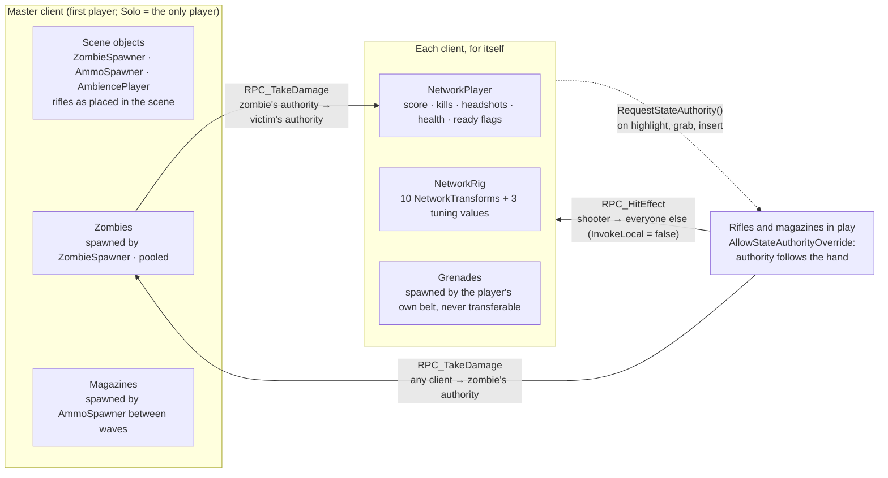

# VR Survival Zombies

2-player online co-op VR zombie shooter · Unity 6 (URP) · Photon Fusion 2 (Shared Mode) · AutoHand · Final IK · Meta Quest 2 / 3 / 3S

**Early Access on the Meta Horizon Store** → [store page](https://www.meta.com/experiences/vr-survival-zombies/1310775452126168/) (trailer and screenshots there)

- **Authority-on-approach weapons**: a rifle changes owner while the arm is still reaching for it, so the first grab never feels heavy.
- **3 RPCs in the whole game**; everything else is replicated state, so late observers, pooled respawns and the offline Solo runner need no special cases.
- **30 → 72 fps on Quest 3S**, one change per measurement, GPU 95% → 80-85%.
- **83 EditMode tests** on the gameplay rules the shipped code actually calls.
- **Full-body networked avatar**: 10 NetworkTransforms on the wire, VRIK solved locally on every client.

[Architecture](#architecture-fusion-2-shared-mode) · [Performance](#performance-on-quest-measured) · [Tests](#tests) · [Known issues](#known-issues) · [Setup](docs/SETUP.md) · [Systems in depth](docs/SYSTEMS.md) · [Engineering lessons](docs/ENGINEERING_LESSONS.md) · [Changelog](docs/CHANGELOG.md)

> Third-party assets (Photon SDK, AutoHand, Final IK, art and audio packs) are not included; see [Setup](docs/SETUP.md). Everything under `Assets/Scripts/` is original or rewritten code.

## What it is

Two players share a storm-lit arena against endless waves. Weapons are physical: eject the magazine, grab a fresh one from the dispenser, slam it in, rack the slide. Your partner sees your whole body move, not floating hands. Solo Survival runs the same code with no cloud and works offline.

## Systems

The short version. Each system is described in full, with its reasoning and measurements, in [Systems in depth](docs/SYSTEMS.md).

### Weapons
- Authority follows the hand: requested on highlight, on grab and when a magazine is inserted; re-requested every 0.5 s while held.
- A shot is a change of `LastShootTick` plus its impact point. Proxies play muzzle, audio and a tracer once; there is no RPC per bullet.
- Impacts are the one per-shot RPC (`InvokeLocal = false`). Only the shooter raycasts; the zombie's authority applies the damage. Headshots are measured to the head bone and deal 2x.
- The round in the chamber is replicated. AutoHand keeps it private per client, which would leave a rifle racked by one player unable to fire for the other.
- Feel: recoil, slide punch, pitched hitmarkers, shell casings, tracers, haptics. A released rifle floats where you let go of it.

### Ammo
- 100-round magazines; between waves the master keeps one magazine on each dispenser. Players physically swap them.
- The loaded magazine follows the rifle on every screen: a replicated `NetworkBehaviourId`, reparented per client.
- Belt grenades are personal (only their spawner can grab them) and re-seat themselves if AutoHand drops one.
- Blast damage walks the zombie registry by distance. No physics query, no layer mask, no allocation.

### Zombies and waves
- NavMesh state machine (Idle / Chase / Attack / Retreat / Dead) simulated on the master. Animation speed mirrors agent velocity.
- Nearest-player targeting with 1.5 m stickiness. A pack fans out onto a ring of attack posts so every zombie gets a bite: 6 of 6 in range, previously 1-2.
- Melee with range hysteresis; the bite lands mid-swing and can be dodged by stepping back.
- Synchronous paths on a NavMesh baked for the play volume only (2,125 triangles instead of 23,618), warp-and-retry recovery, pooled instances.
- Waves ramp linearly with intermissions and an event-driven alive count; Solo is rebalanced for one rifle.

### Avatar
- Mixamo humanoid driven by VRIK. Head and both hands are the only replicated IK data; every client solves the body.
- Grab-aware hand targets: the controller frame with empty hands, the physical hand while holding something.
- Camera-anchored body with an anatomical head pivot (12 cm behind the eyes), floor-raycast height calibration, arm reach through `armLengthMlp`.
- Exactly one solve per frame, after AutoHand's `LateUpdate`. Wrist offsets were tuned live in the headset.
- The local head, neck and hands are hidden; the partner sees the full body with a gaze-following head lamp.

### Lobby, tutorial and sessions
- Seven-step in-world tutorial with props that appear at their step, skippable with A. Steps only advance from objects in the local player's own hands.
- Room codes in large type, listed from Photon's session lobby and namespaced by build version. Duplicate codes resolve themselves.
- Strict co-op disconnect rules: the host leaving ends the match with a clear screen; a 25 s timeout rides out Wi-Fi hiccups.
- Death spectator that follows the partner by translation only and never re-aims the tracked eyes (unit-tested follow model).
- Solo Survival: Fusion `Single` mode, the same netcode, no internet required.

### Game feel
- Authoritative kill credit from `RpcInfo.Source`; multi-kill combos coalesced per frame; a lazy-follow HUD; end screens sized for a headset.
- Two-layer music that crossfades with horde pressure, a slow-motion beat on the last kill, a lightning storm, a procedural heartbeat below 35% health.
- Pooled impacts, muzzle flashes, popups and 3D voices: no allocation in a firefight.

### Quest configuration
- A dedicated URP asset and renderer: MSAA 4x, no HDR, no post-processing, no main-light shadows, render scale 1.0, fixed foveated rendering. The post profile's colour grade is baked into sky, fog and lights at load.
- One skinned renderer per zombie (14 parts combined), occlusion culling, baked lobby lights, instanced grass with a per-platform budget, streamed audio, 2048 texture overrides.
- Manifest audited against Meta's permission lists; install location, orientation and target devices set for the store validator.

## Architecture (Fusion 2 Shared Mode)

| Concern | Pattern |
|---|---|
| Persistent state (health, wave, ammo, shot tick) | `[Networked]` properties + `ChangeDetector` |
| Transient events with payload (impacts, damage) | RPCs, `InvokeLocal = false` when the sender already played locally |
| Object ownership | Rifles and magazines: State Authority requested on approach (`AllowStateAuthorityOverride`). Grenades: personal to their spawner. The master simulates zombies and waves |
| Avatar sync | NetworkTransforms on root, body, IK targets and anchors; VRIK solved locally; proxies interpolate, the owner writes live |
| Held objects | `NetworkTransform` replicates local coordinates, so held objects keep their scene-root parent while in a hand |
| Spawning | `PooledObjectProvider` recycles zombies; everything else uses Fusion's default instantiate/destroy |
| Sessions | One Photon session lobby per build version; room code = session name; the room closes once the arena loads |

### Authority map

Shared Mode has no server: every `NetworkObject` has exactly one client as its State Authority, normally whoever spawned it, and proxies render what that client replicates. Who owns what, and the only three paths that cross those boundaries:

- **Master client** = `Runner.IsSharedModeMasterClient`, or the lone player in Solo, wrapped as `NetworkManager.IsMatchAuthority`. It runs the wave clock, spawns zombies and magazines and simulates every zombie. If it leaves, the match ends by design.
- **Each client** owns its player object, its rig and the grenades its belt spawns. Nothing about a player is ever written by another client: damage arrives as an RPC and the victim's own authority applies it.
- **Rifles and magazines** are the only objects whose authority moves, so their physics (`NetworkRigidbody3D`) and shot state always run on the client holding them.
- **Kill credit** rides on the damage RPC: the zombie's authority stores `RpcInfo.Source` in `LastDamager`, and the killer's client credits the score it owns when the death replicates.

### Replicated state vs RPCs

The rule: **state that must be true for anyone who looks later is `[Networked]`; one-shot events with a payload that only matter in the moment are RPCs.** Everything on the wire, from the code:

| Object (authority) | `[Networked]` state | RPCs | Notes |
|---|---|---|---|
| `NetworkZombie` (master) | `Health`, `State`, `AnimSpeed`, `LastDamager`, `DiedByHeadshot`, `DiedFromBehind`, `AttackTick`, six `TickTimer`s (attack cooldown, pending hit, stagger, retarget, wander, despawn) | `RPC_TakeDamage(amount, headshot, fromBehind)` any → State Authority | Attacks, deaths and blends replicate as state, detected with a `ChangeDetector`; proxies never raycast or decide |
| `ZombieSpawner` (master, scene) | `CurrentWave`, `IsIntermission`, `GameOver`, `WaitingForPlayers`, `ZombiesLeftToSpawn`, two `TickTimer`s | none | Every HUD reads the wave state; only the master advances it |
| `NetworkPlayer` (its player) | `Health`, `IsDead`, `TotalScore`, `Kills`, `HeadshotKills`, `Ready`, `TutorialDone` | `RPC_TakeDamage(amount, attackerPos)` any → State Authority | Lobby gates are plain state, so a late observer sees the truth |
| `NetworkRig` (its player) | 10 `NetworkTransform`s + `TunedLive`, `TunedElbowHintOffset`, `TunedArmLengthScale` | none | Pose is pure state; VRIK solves locally from the replicated targets |
| `NetworkAutoGun` (holder) | `LastShootTick`, `LastShootPoint`, `SlideLocalPosition`, `LoadedMagId`, `Chambered` + `NetworkRigidbody3D` | none | A shot is a change of `LastShootTick`; proxies play it once when the change arrives |
| `NetworkGunHitEffect` (holder) | none | `RPC_HitEffect(point, normal)` shooter → all, `InvokeLocal = false` | The one true event with payload: a decal has no future state |
| `NetworkAutoAmmo` (holder) | `NetworkedAmmo` + `NetworkTransform` | none | Rounds left is state; authority follows the magazine into whoever's rifle |
| `NetworkGrenade` (thrower) | `Armed`, `Exploded`, `FuseTimer`, `DespawnTimer` + `NetworkTransform` | none | The explosion is a state flip; the thrower's authority applies damage through the zombies' RPC |
| `AmbiencePlayer` (master, scene) | `ClipIndex` | none | One random pick per match, heard by both players |

Three RPCs in the whole game, all of them damage or impact events. Everything else is state, which is what makes late observers, pooled respawns and the Solo runner work without special cases. The full audit of the 15 networked systems is in [docs/NETCODE_AUDIT.md](docs/NETCODE_AUDIT.md); the reasoning behind the code's shape in [docs/DESIGN_DECISIONS.md](docs/DESIGN_DECISIONS.md).

## Performance on Quest (measured)

All numbers from **OVR Metrics Tool** on a **Quest 3S**, in the arena, in a wave with six zombies alive, read for a few minutes per build. Target: 72 fps with the GPU under ~85%, which leaves room for thermal throttling. Compositor log lines are not used for this: they report what was displayed, not how much GPU was left, which is how a 30 fps build once looked like a 72 fps one.

| Build (one change per measurement) | FPS | GPU | CPU |
|---|---|---|---|
| Render scale 1.4, post-processing, main-light shadows (what the first store review tested) | 30-32 | 95%+ | < 20% |
| 1. Render scale 1.4 → 1.0 | 50-56 | 95%+ | ≤ 49% |
| 2. Post-processing off on the Quest renderer | 59-72 | 90-95% | ≤ 45% |
| 3. Main-light shadows off | 68-73 | 85-95% | 30-35% |
| 4. Fixed foveated rendering, level 1.0 | **70-72** | **80-85%** | 30-35% |

At 1.4 the game rendered 1.96x the panel's pixels; the post pass cost about ten frames for a Bloom that never triggered without HDR; the shadow pass redrew 386 renderers for a 0.32-intensity moon; foveation bought the last margin without touching the centre of the view. The one known hitch is a single dip to 56 fps in the first round, when the Vulkan driver compiles each effect's pipeline state the first time it is drawn.

**Netcode and gameplay probes** (editor, per-frame sampling):

| Probe | Result |
|---|---|
| Gap between a zombie's NavMesh position and its rendered transform in Solo, 1235 moving frames | 0.0 cm |
| Held rifle authority pull-back with `DisableSharedModeInterpolation` off / on | up to ~0.11 m / 0 |
| Six zombies spawned in a column 9 m away, in bite range after 12 s | 5 of 6, then 6 of 6 (before: 1-2) |
| Game-over retreat: pending-path frames / agent speed | 2% / 0.60 m/s steady (before: ~50% / stutter) |
| Zombie foot travel during 4 s of retreat, *Cull Update Transforms* → *Always Animate* | 17.8 cm then frozen → 104 cm |
| Re-grabbing a rifle after it floated | 1.1 cm steady hand-to-grip gap, no shake |

How to reproduce, and the diagnostics the editor can pull from the headset, are in [docs/SETUP.md](docs/SETUP.md).

## Tests

**83 NUnit EditMode tests, all passing** in under two seconds. They cover the pure logic lifted out of `NetworkBehaviour`s into engine-only assemblies (`VRZ.Core`, `VRZ.Avatar`), so they need no scene, no headset and no Fusion session.

| Suite | Tests | Pins down |
|---|---|---|
| `AvatarScaleCalibratorTests` | 12 | Height scale snaps on the first reading and converges after; crouch, headset-on-desk and floor-relative rules |
| `ElbowPoleTests` | 8 | Bend-plane geometry, mirroring, degenerate inputs, `Aim` blending |
| `PoseSmootherTests` | 7 | Framerate-independent filter, no lag on the first sample, reset semantics |
| `WaveRulesTests` | 15 | Wave size ramp, ready count ignores invalid players, "all players dead" |
| `GrenadeRulesTests` | 7 | Blast falloff: full at the centre, 25% at the edge, linear between, never increasing |
| `ZombieDamageRulesTests` | 6 | Lethal and overkill hits, corpses take no damage, negative damage never heals, last hit gets the kill |
| `SpawnRulesTests` | 5 | Distinct spawn slots with the non-consecutive ids of a leave/rejoin |
| `RoomCodeRulesTests` | 7 | Two-digit codes, taken codes skipped, the last free code always found |
| `FloorSamplerTests` | 8 | Against real colliders: highest surface wins, hands and triggers are not ground, rising ground eases in |
| `SpectatorFollowTests` | 8 | The spectator's own head never moves the rig; the partner turning never orbits the view |

The rules under test are the code the game calls (`NetworkGrenade`, `NetworkZombie.RPC_TakeDamage`, `MapDefault`, `SessionMenu`), not copies. Writing them closed two edge cases: negative damage over the RPC can no longer heal a zombie, and room-code selection always finds a free code. Networking, hands and held objects are verified in two-build headset sessions instead. Run: **VRZ > Run EditMode Tests**, or headless with `Unity.exe -batchmode -runTests -testPlatform EditMode -assemblyNames VRZ.Tests.EditMode`.

## Known issues

- The room list is public within a build version; a private code-entry join would need a keypad.
- If the host leaves, the match ends (by design for strict co-op); continuing would need master-client scene objects and `IStateAuthorityChanged` on every zombie.
- Solo with no internet waits for the room-directory attempt to time out before the button enables, and the lobby then shows Photon's raw error text.
- A hand near someone else's held rifle can take its authority for up to 0.5 s; shots fired in that gap are not replicated. Never observed in play.
- Photon region fixed to `us`: players elsewhere pay the round trip. Chosen because clients picking different regions cannot see each other's rooms.
- One dip to 56 fps in the first round of a session (pipeline compilation); a graphics-state warm-up is the candidate fix.
- Pressing the Meta button keeps rendering but does not hide the hands or pause input (VRC.Quest.Input.4); next update.

## Roadmap

Pause and host reconnection · private rooms with a keypad · reviving a downed partner · walking legs for the avatars (VRIK animated locomotion on a 2D blend tree). Grenades and magazines are deliberately not pooled: they spawn only during intermissions, where the cost is invisible.

## Docs

- [docs/SETUP.md](docs/SETUP.md): project structure, external assets, Fusion config, Quest build settings, testing alone, netcode diagnostics, the editor as a stand-in partner.
- [docs/SYSTEMS.md](docs/SYSTEMS.md): every system in depth, with reasoning and measurements.
- [docs/DESIGN_DECISIONS.md](docs/DESIGN_DECISIONS.md): contracts, assemblies, events, pools, test switches.
- [docs/NETCODE_AUDIT.md](docs/NETCODE_AUDIT.md): the September audit of the 15 networked systems.
- [docs/ENGINEERING_LESSONS.md](docs/ENGINEERING_LESSONS.md): 27 bugs worth remembering, each with the rule that came out of it.
- [docs/CHANGELOG.md](docs/CHANGELOG.md): every build that reached a headset.

## Credits

- Networking and gameplay integration, grenade VFX and fog texture: the repository author.
- Session/spawn scaffolding started from the IronHeadVR Udemy course by [IronHead Games](https://www.udemy.com/user/ironhead-games/) and [Tevfik Ufuk Demirbas](https://www.udemy.com/user/tevfik-ufuk-demirbas/); rewritten for AutoHand and Fusion 2, course content not included.
- AutoHand by Earnest Robot · Final IK by RootMotion · Photon Fusion by Exit Games. VR body approach inspired by [Valem's tutorial](https://www.youtube.com/watch?v=v47lmqfrQ9s); the grab-aware hand targeting follows AutoHand's own VRIK example.
- Development tooling: two editor-only MCP bridges (`com.coplaydev.unity-mcp`, `com.lazyray.mcp`) as embedded, git-ignored packages with editor-only runtime shims, so nothing enters the APK; `Assets/Plugins/Roslyn/` holds Microsoft's Roslyn assemblies (MIT) used by that tooling.
